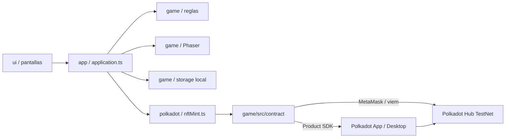
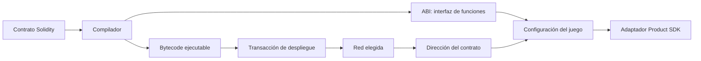

# Arquitectura: de la interfaz al smart contract

## Estado actual

Una sola app web (Vite + TypeScript + Phaser) en la raíz, publicada en `polka-pets.dot`:

- **Juego:** nombre → elegir mascota (5 especies) → adoptar como NFT (opcional) → habitación.
  Los cuidados son locales y gratis; se guardan en el dispositivo.
- **Firmas:** solo dos, ambas opcionales: adoptar (`mint` en PolkaPets) y, al morir la mascota,
  registrar la partida (`registrarMuerte` en PolkaPetsRanking).
- **Accesorios y muebles (NFT):** con un NFT de mascota y `ITEMS_ADDRESS` configurado
  (`game/src/contract/config.ts`), comprar en la tienda firma `comprar(mascotaId, articuloId)` en
  `PolkaPetsItems`. El contrato crea un NFT ligado a esa mascota (no transferible) y los pesitos 🪙,
  que son locales, solo se descuentan si la firma se confirma. Qué está puesto no es una
  transacción por cambio: se guarda en el dispositivo y se declara una sola vez al morir con
  `sellarLegado` (tiempo vivido, objetos comprados y puestos). El contrato valida ahí un accesorio,
  una pared y un piso a la vez, un mueble o adorno por categoría y el máximo de lugares. Otra
  mascota nueva no tiene acceso a los objetos de la anterior (en cadena por `mascotaId`; en el
  cliente se vacía la tienda local al empezar). Sin `ITEMS_ADDRESS` la tienda sigue siendo local.
- **Trofeos (logros):** `src/game/achievements.ts` define 9 logros por tiempo vivido y por tamaño de
  la colección (mismos números que `_logro(...)` en el contrato). Con NFT, reclamar uno firma
  `reclamarLogro`: el contrato comprueba por su cuenta el tiempo desde la adopción y los objetos que
  esa mascota compró, exige que siga viva y crea un NFT ligado a ella. Sin NFT se ganan solos y se
  guardan en el dispositivo. `sellarLegado` también guarda los trofeos ganados.
- **Premios y bonos:** cada trofeo da pesitos 🪙 (locales, los acredita el juego) y algunos, un
  accesorio exclusivo (`recompensa` en el contrato) que se mintea junto al trofeo y no se puede
  comprar (`SoloPorLogro`). Los accesorios pueden dar bonos (`bonus` en `src/game/shop.ts`: % de
  pesitos o de felicidad en los minijuegos), que suma `src/game/bonuses.ts`. Los bonos solo afectan
  la economía local; no cambian lo que se firma ni lo que valida el contrato.
- **Quién firma:** dentro de la Polkadot App o Desktop, el Host (Product SDK 0.39.0); en un
  navegador normal, una wallet EVM como MetaMask (`viem`).
- **Contratos** en Polkadot Hub TestNet (chain id 420420417):
  - PolkaPets `0x758425A3b756079B34FF97cB9C7A764fD44C008a` (`NUM_ESPECIES = 1`: el mint usa la
    especie 0 como comodín y el juego muestra el animal elegido).
  - PolkaPetsRanking `0xf675957A89bfF3e02BD8AeB302Ca2E8Ca6f2a5d2` (leaderboard).

`product-app/` y `product-contract/` son otra ruta (PolkaVM en Paseo) que la app no usa.

## Mapa de carpetas

```text
src/
├── main.ts, app/bootstrap.ts       # punto de entrada Vite
├── app/
│   ├── application.ts              # controlador: pantallas, cuidados, mint, registro y música
│   └── chainApplication.ts         # modo NFT con firma por cuidado (no se abre hoy)
├── game/                           # reglas puras (petState, config, catalog, storage) y Phaser (petScene)
├── ui/                             # pantallas y diálogos: inicio, mascota, mint, juego, registro, ranking
├── infrastructure/audio/music.ts   # música original con Web Audio
└── polkadot/nftMint.ts             # adaptador: conectar, mint, registrar y leer el leaderboard

game/src/
├── contract/                       # config, ABI, pets.ts (viem), host.ts (Product SDK), ranking.ts
├── hub/, engine/, lib/             # estado y reglas del modo NFT con firma por cuidado (+ tests)

contrato/                           # Hardhat: PolkaPets.sol, PolkaPetsRanking.sol, tests y scripts
```



## Las piezas y su responsabilidad

| Pieza | Qué hace | Qué no debe hacer |
|---|---|---|
| Interfaz | Dibuja la mascota, botones, indicadores y mensajes de progreso. | Guardar reglas blockchain dentro de los componentes visuales. |
| Reglas del juego | Decide si una acción de juego es válida y calcula hambre, energía, ánimo, puntos o logros. | Firmar o enviar transacciones. |
| Adaptador del contrato | Traduce una acción del juego a una función del contrato; adapta respuestas y errores. | Guardar una llave privada o inventar funciones que no están en la ABI. |
| ABI y dirección | La ABI describe funciones, tipos, eventos y errores. La dirección señala dónde vive el contrato en una red concreta. | La ABI no contiene secretos ni el código fuente completo. |
| Product SDK / TrUAPI | Ofrece al Product las capacidades del Host para consultar cadenas, pedir firmas y usar almacenamiento. | Firmar automáticamente por la persona. |
| Host | Aplica permisos, dirige consultas y transacciones y lleva las solicitudes de firma al dispositivo que custodia la llave. | Cambiar las reglas del contrato. |
| Wallet de Polkadot App | Muestra la solicitud y firma solo si la persona aprueba. | Entregar la llave privada al juego. |
| Red y contrato | Validan la transacción; el contrato ejecuta sus reglas y la red conserva el estado acordado. | Saber si la persona realmente jugó fuera de lo que la transacción demuestra. |

En un Product `.dot`, el juego no habla con la red usando `fetch`, un WebSocket o una llave privada.
Pide esas capacidades al Host por el Product SDK / TrUAPI, que es el límite de seguridad del
Product. [Referencia de TrUAPI y sandbox](https://docs.polkadot.com/reference/apps/protocol/truapi/sandbox/)

## Un clic que cambia el estado en cadena

Ejemplo: la persona termina una misión y toca **Guardar logro**.

1. **Interfaz:** el botón manda una intención como `guardarLogro("primer-paseo")` al controlador.
   La pantalla puede mostrar “Preparando…” y bloquear el botón para evitar doble envío.
2. **Cuenta del Product:** cuando la app se conecta, el SDK pide al Host la cuenta derivada para
   este Product. La app recibe una dirección pública; no recibe la llave privada. Esa dirección
   determina quién aparece como `msg.sender` en el contrato.
3. **Reglas:** el juego comprueba las condiciones que conoce. Esta comprobación mejora la
   experiencia, pero no es una prueba de seguridad: alguien puede modificar el frontend.
4. **Adaptador:** selecciona una función real de la ABI, por ejemplo
   `claimAchievement(id)`, y le pasa los argumentos correctos. Debe usar la dirección del contrato
   desplegado en la red elegida.
5. **Consulta / simulación (`query`):** el Product SDK solicita al Host una ejecución de prueba. La
   llamada no guarda el cambio y no necesita la firma de una transacción. Sirve para detectar antes
   errores conocidos, como un logro inválido o ya reclamado.
6. **Resultado de simulación:** si el contrato rechaza la llamada, la interfaz explica el motivo y
   termina aquí. La simulación no reserva el estado: otra transacción podría cambiarlo antes de la
   nuestra, así que el contrato vuelve a validar todo al ejecutar la transacción real.
7. **Solicitud de firma (`tx`):** si la simulación pasa, el Product SDK pide al Host enviar la
   transacción. El Host la presenta a la Polkadot App. El usuario ve y aprueba o rechaza; la llave
   privada permanece en la wallet.
8. **Envío:** después de la aprobación, el Host transmite la transacción firmada. Hace falta pagar
   el costo de ejecución según las reglas de la red y los permisos disponibles.
9. **Ejecución:** la red incluye la transacción y ejecuta el contrato. El contrato valida de nuevo
   que `msg.sender` tenga derecho a reclamar el logro, actualiza el estado y puede emitir un evento.
10. **Confirmación:** el SDK informa si se envió, se incluyó en un bloque y alcanzó el nivel de
   confirmación solicitado. La interfaz debe distinguir “enviado” de “confirmado”.
11. **Relectura:** el juego vuelve a consultar el estado del contrato y actualiza la pantalla con el
    valor que devuelve la red. El hash de transacción puede mostrarse para que el usuario lo revise.

La API vigente de Polkadot para Products presenta este patrón como consultas `query` de simulación
y escrituras `tx` que pasan por el Host. [Guía oficial: añadir un smart contract a un Product](https://docs.polkadot.com/apps/build/deploy-a-smart-contract/)

### Errores que debe mostrar la interfaz

- **La persona rechaza:** cancelar sin decir que el logro se guardó.
- **No hay permiso o cuenta conectada:** explicar cómo conectar o conceder el permiso necesario.
- **La simulación falla:** mostrar el error decodificado del contrato y no abrir una firma.
- **No hay fondos/permiso de gas:** explicar que no se envió la transacción.
- **La red tarda o se desconecta:** mostrar “pendiente” o “no confirmado”; verificar el estado antes
  de repetir para evitar duplicados.
- **El contrato revierte:** mostrar fallo aunque el usuario sí haya firmado.

## Antes de que una persona use el contrato

La integración de ejecución depende de un contrato ya compilado y desplegado. Ese es un flujo
separado del clic en el juego:



El despliegue produce una dirección para **esa red**. La ABI y esa dirección se configuran en el
juego; la aplicación no debe incluir la frase semilla, la llave del deployer ni secretos. Si se
cambia de red o se despliega una versión nueva, hay que revisar dirección y ABI.

## Qué vive dentro y fuera del contrato

Para el Tamagotchi, una primera división razonable sería:

| Juego local | Contrato (solo si decidimos que sea verificable/compartido) |
|---|---|
| Animación, sonidos y estado visual instantáneo. | Identificador y propietario de una mascota, si queremos propiedad verificable. |
| Necesidades que cambian con cada minuto. | Logros reclamados que otros jugadores deban poder comprobar. |
| Preferencias y tutorial. | Un registro público de acciones con reglas anti-duplicado. |

Cada escritura requiere una transacción que puede requerir firma y costo. Por eso alimentar,
limpiar o jugar no debería tocar el contrato automáticamente en cada clic. Si queremos que la mascota
y su progreso se recuperen al cambiar de dispositivo, primero elegimos qué estado mínimo será
canónico en cadena; el resto puede seguir en almacenamiento local. En Polkadot Products, el grupo
Local Storage es por Product y dispositivo. [Referencia oficial de Local Storage](https://docs.polkadot.com/reference/apps/protocol/truapi/local-storage/)

## Dónde aplica MVC

Podemos organizar **el frontend** con MVC sin convertir el contrato en un “modelo MVC”:

- **Modelo:** estado y reglas puras del Tamagotchi.
- **Vista:** canvas de Phaser, paneles, barras y botones HTML/CSS.
- **Controlador:** interpreta el clic, llama a las reglas o al adaptador y actualiza la vista.
- **Adaptador blockchain:** capa adicional que encapsula SDK, ABI, dirección, consultas, firmas y
  errores. Mantenerla separada deja probar las reglas del juego sin abrir una wallet.

El contrato se organiza y se despliega como componente independiente. El proyecto completo puede
vivir en un monorepo, pero la web y el contrato tienen compilación, pruebas y despliegues distintos.


